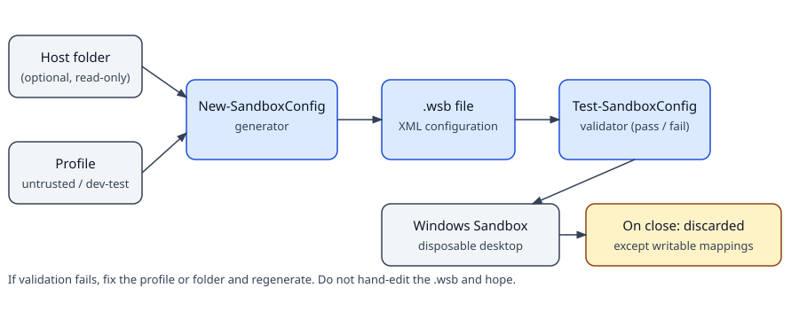

# windows-sandbox-toolkit

[](https://github.com/enonymous1/windows-sandbox-toolkit/actions/workflows/ci.yml)
[](LICENSE)

## Description

Windows Sandbox is a lightweight, temporary, isolated desktop built
into Windows. You run software in it, close it, and everything
inside is discarded. A `.wsb` file is how you control that
session: networking, GPU sharing, mapped folders, clipboard,
microphone, camera, and a command to run at logon.

This toolkit stops you hand-editing that XML and hoping it
launches. It gives you:

- Three ready-to-use profiles (`configs/`): a locked-down
  profile for software you do not trust, one for installers that
  need the network, and one for your own builds.
- A generator (`scripts/New-SandboxConfig.ps1`) that builds a
  `.wsb` file from a profile, with overrides, and validates its
  own output before reporting success.
- A validator (`scripts/Test-SandboxConfig.ps1`) that checks any
  `.wsb` file against the documented schema before you launch it.
- A preflight script (`scripts/Enable-WindowsSandbox.ps1`) that
  checks your Windows edition, virtualization, and the Sandbox
  feature, and can turn the feature on.
- One schema file (`schema/wsb-schema.json`) that the generator,
  validator, and tests all read, so the tools cannot quietly
  disagree with each other about what a valid configuration is.

This is not a virtual-machine manager, not a persistence layer,
and not Microsoft's Windows Sandbox itself. It only produces and
checks the configuration files that Windows Sandbox consumes.
Closing a sandbox still discards everything inside it, except
changes to a writable mapped folder (see
[`docs/profiles.md`](docs/profiles.md)).



## Prerequisites

To *run* a sandbox (not just to generate or validate a file):

- **Windows 10 Pro or Enterprise**, build 18342 or later for
  `.wsb` files (18305 introduced Sandbox itself), **or Windows 11
  Pro, Enterprise, or Education**.
- **Not Windows Home.** Sandbox is not available on Home, on
  either Windows 10 or 11.
- Virtualization enabled in BIOS/UEFI.
- The Windows Sandbox feature turned on (see Quick start).
- At least 2 CPU cores (4 with hyperthreading recommended) and
  4 GB RAM (8 GB recommended).

To *use the tools*:

- PowerShell 5.1+ or PowerShell 7+. The generator and validator
  run on Linux/macOS PowerShell too for everything except
  launching a `.wsb` and enabling the feature, which are
  Windows-only by definition.
- Python 3.8+ is only needed for `tests/test_configs.py`, and
  that test uses the standard library only (no dependencies to
  install).

## Installation

There is nothing to build and nothing to install. Clone the
repository and use the scripts in place:

```powershell
git clone https://github.com/enonymous1/windows-sandbox-toolkit.git
cd windows-sandbox-toolkit
```

If PowerShell refuses to run a downloaded script, unblock it
rather than lowering your execution policy globally:

```powershell
Get-ChildItem -Path .\scripts -Filter *.ps1 | Unblock-File
# or, for the current user only:
Set-ExecutionPolicy -Scope CurrentUser RemoteSigned
```

Keep the repository structure intact. The scripts are a package,
not standalone files: they import `scripts/SandboxSchema.psm1`
and read `schema/wsb-schema.json`. Copying a single script out
on its own will fail with a clear error telling you why.

## Quick start

```powershell
# 1. Check your edition, virtualization, and the feature.
#    Run PowerShell as administrator for -Enable.
.\scripts\Enable-WindowsSandbox.ps1
.\scripts\Enable-WindowsSandbox.ps1 -Enable   # if it reports off

# 2. Launch a shipped profile as-is (or double-click it).
.\configs\untrusted.wsb

# 3. Or generate one for a specific folder, read-only, and launch it.
.\scripts\New-SandboxConfig.ps1 -Profile Untrusted `
    -HostFolder 'C:\Users\Public\Downloads\untrusted' `
    -OutputPath '.\untrusted-test.wsb' -Launch
```

<!-- Visual asset placement: docs/assets/end-to-end.gif goes here,
     directly after Quick start. It should be a ~30-second screen
     recording (not a mock) of step 3 end to end: generate, validate,
     launch, close, and the discard confirmation. See REVIEW.md. -->

## Profiles

| File | For | Networking | Clipboard | GPU | Protected Client |
| --- | --- | --- | --- | --- | --- |
| `configs/untrusted.wsb` | Software you do not trust | Off | Off | Off | On |
| `configs/installer-test.wsb` | Installers that need the network | On | Off | On | Off |
| `configs/dev-test.wsb` | Your own builds | On | On | On | Off |

All three map no folder by default, disable microphone, camera,
and printers, and set 4096 MB of memory. See
[`docs/profiles.md`](docs/profiles.md) for when to use each and
what survives closing the sandbox.

<!-- Visual asset placement: docs/assets/sandbox-untrusted.png goes
     here, directly after the Profiles table. It should be a real
     screenshot of a Windows Sandbox desktop launched from
     configs/untrusted.wsb, with the sandbox window and a visible
     read-only mapped folder on its desktop. See REVIEW.md. -->

## Generator

`scripts/New-SandboxConfig.ps1` builds a `.wsb` from a profile
with your overrides:

```powershell
# Your own build, more memory, writable mapping for test output.
.\scripts\New-SandboxConfig.ps1 -Profile DevTest -MemoryInMB 8192 `
    -HostFolder 'C:\dev\myapp\bin' -AllowWrite `
    -OutputPath '.\dev-test.wsb'

# One logon command: it must exist INSIDE the sandbox. For a
# multi-step setup, map a script in and run that instead.
.\scripts\New-SandboxConfig.ps1 -Profile Untrusted `
    -HostFolder 'C:\Users\Public\Downloads\untrusted' `
    -LogonCommand 'C:\Users\WDAGUtilityAccount\Desktop\untrusted\setup.bat' `
    -OutputPath '.\untrusted-test.wsb'
```

If you pass a host folder that does not exist, the generator
refuses to write the file -- Windows Sandbox fails to start in
that case, so failing early here saves a confusing launch. The
one exception is an env-var path (for example
`%USERPROFILE%\Downloads\untrusted`) whose variable is not set
on the checking machine: that check is skipped with a warning,
because Windows Sandbox supports env-var paths on Windows 11
23H2 and later. A writable mapping always warns, even when you
asked for it, because that warning is the record that changes to
that folder will persist after the sandbox closes.

## Validator

`scripts/Test-SandboxConfig.ps1` checks a `.wsb` against the
schema before you launch it:

```powershell
.\scripts\Test-SandboxConfig.ps1 -Path '.\configs\untrusted.wsb'
.\scripts\Test-SandboxConfig.ps1 -Path '.\myconfig.wsb' -SkipHostFolderCheck
```

It rejects unknown elements and values, duplicated elements, a
non-numeric or non-positive `MemoryInMB`, a `<MappedFolder>`
without a host folder, a relative host folder, an empty
`<MappedFolders>` block, and a mapped host folder that does not
exist on this machine. It warns (but does not fail) on memory
below 2048 MB, which Windows Sandbox raises automatically, and
on writable mapped folders. It parses with DTD processing
prohibited and no XML resolver, so a crafted file cannot trigger
external entity resolution while you are only checking it.

<!-- Visual asset placement: docs/assets/validator-output.png goes
     here, directly after the Validator examples. It should be a
     real terminal screenshot showing the validator passing all
     three shipped profiles and rejecting a bad file with its
     error message. See REVIEW.md. -->

## Local Development

No build step. The checks below are what CI runs, and what you
should run before opening a pull request.

```powershell
# Validate every shipped profile.
Get-ChildItem -Path '.\configs' -Filter '*.wsb' | ForEach-Object {
    .\scripts\Test-SandboxConfig.ps1 -Path $_.FullName
}

# Generator and validator behaviour tests (no Pester needed).
# Folder-mapping cases only run on Windows; on other platforms
# they print SKIP and the rest of the suite still runs.
pwsh tests/Test-Generator.ps1

# PSScriptAnalyzer, any finding fails (CI does the same).
Install-Module PSScriptAnalyzer -Force -Scope CurrentUser
Invoke-ScriptAnalyzer -Path '.\scripts'
```

```bash
# Same schema checks, cross-platform, no PowerShell needed.
python3 tests/test_configs.py
```

What cannot be tested on Linux/macOS, and must be checked on
Windows: generating with a real mapped folder, launching a
`.wsb`, running `Enable-WindowsSandbox.ps1`, and the CI run
itself (which runs on `windows-latest`). If you change a
profile, change it in `schema/wsb-schema.json` first, then
re-run the tests: they check that the shipped `.wsb` files
match the schema exactly, so a drifted profile fails loudly
instead of silently reverting an option to its default.

## Deployment

### Publishing this repository

Push `main` normally; CI runs on every push and pull request.
There is no website or package to deploy -- this repository
ships scripts and configuration files, not a built artifact.

```powershell
# From a fresh extraction, after creating the empty public repo:
git remote add origin https://github.com/enonymous1/windows-sandbox-toolkit.git
git push -u origin main
```

After the first push, set the repository description and topics
(they are not stored in the repository itself):

```powershell
gh repo edit enonymous1/windows-sandbox-toolkit --description 'Ready-to-use Windows Sandbox (.wsb) profiles, plus a PowerShell generator, validator, and enablement preflight.' --add-topic windows-sandbox --add-topic wsb --add-topic powershell --add-topic windows-11 --add-topic security
gh repo view enonymous1/windows-sandbox-toolkit --json description,repositoryTopics
```

Releases are tagged from `main` (`git tag v1.1.0`, then push the
tag) and described in [`CHANGELOG.md`](CHANGELOG.md).

### Deploying a configuration to a machine

There is no installer. Copy the `.wsb` file (shipped or
generated) to the target machine and double-click it, or launch
it from PowerShell. The target machine must meet the
Prerequisites above, and any mapped host folder must exist on
that machine, or the sandbox will fail to start -- run the
validator on that machine first if you are unsure.

## Security notes

- The shipped defaults are deliberately the safe side of the
  documented defaults: stock Sandbox enables networking and
  clipboard, which is fine for a clean desktop and wrong for
  untrusted software. The Untrusted profile turns both off.
- Never map your whole user profile, Documents, or any folder
  with credentials into a sandbox running untrusted software --
  and never map one writable. Read-only, one folder, one job.
- A sandbox is a boundary, not a guarantee. Keep the host
  patched, and do not treat "it ran in Sandbox" as proof a
  file is safe to run on the host.
- The validator treats a `.wsb` file as untrusted input: it
  parses with DTD processing prohibited, so a malicious file
  cannot use an external entity to read host files during
  validation.

## Layout

```text
configs/    Shipped .wsb profiles (untrusted, installer-test, dev-test)
schema/     wsb-schema.json — single source of truth for the format
scripts/    New-SandboxConfig.ps1  — generator
            Test-SandboxConfig.ps1 — validator
            Enable-WindowsSandbox.ps1 — edition/feature/virtualization preflight
            SandboxSchema.psm1 — shared schema and path helpers
docs/       options.md, profiles.md, assets/architecture.svg
tests/      test_configs.py — Python schema and profile tests
            Test-Generator.ps1 — PowerShell behaviour tests
```

## Options reference

[`docs/options.md`](docs/options.md) documents every `.wsb`
element, its allowed values, its default, and the things the
format cannot do (window size, persistence, snapshots, and
more than one logon command). [`REVIEW.md`](REVIEW.md) documents
the staff review behind v1.1.0, including what was deliberately
not changed and why.

## Reference

Microsoft's Windows Sandbox documentation:
<https://learn.microsoft.com/en-us/windows/security/application-security/application-isolation/windows-sandbox/windows-sandbox-overview>

## License

MIT -- see [LICENSE](LICENSE).
